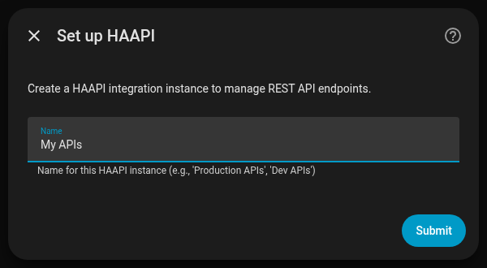
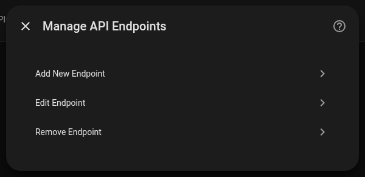
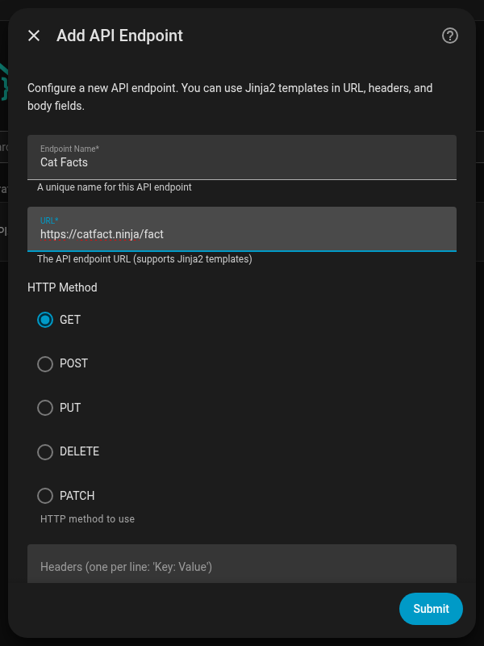
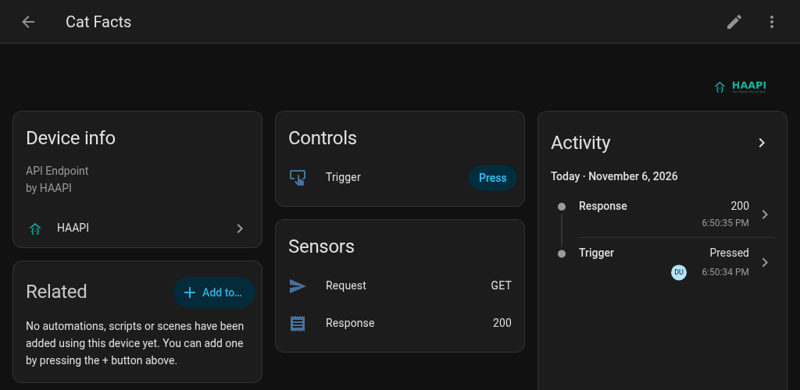

<p align="center">
  
</p>

# HAAPI - Home Assistant API Integration

<p align="center">
  <a href="https://github.com/hacs/integration"></a>
  <a href="https://github.com/Nasawa/HAAPI/releases"></a>
  <a href="https://github.com/Nasawa/HAAPI/actions/workflows/ci.yml"></a>
  <a href="LICENSE"></a>
  <a href="https://ko-fi.com/anigeekapps"></a>
</p>

A universal API integration framework for Home Assistant 2025.11+ where each "device" represents one API endpoint. Configure and trigger API calls with responses stored as entity states and attributes.

> **Compatibility:** The minimum supported Home Assistant version is 2025.11. Integration-specific triggers and conditions require Home Assistant 2026.7 or later, as noted in those sections.

## What it does

HAAPI turns any HTTP API into Home Assistant devices, without YAML. Each endpoint you add becomes a device with:

- a **Trigger** button that makes the call,
- a **Request** sensor showing what will be sent, and
- a **Response** sensor whose state is the HTTP status, with the body and headers as attributes.

URLs, headers and bodies accept Jinja2 templates, and it supports Basic, Bearer and API-key auth. For automations there are HAAPI triggers ("call succeeded", "JSON field changed"…), conditions, and a `haapi.request` action that returns the response directly to the next step.

## Installation

### Marketplace (Recommended)

HAAPI is listed in the Home Assistant Marketplace (formerly HACS, built into Home Assistant since 2026.11).

[](https://my.home-assistant.io/redirect/hacs_repository/?owner=Nasawa&repository=HAAPI&category=integration)

1. Go to **Settings → Marketplace** (or use the button above)
2. Search for **HAAPI** and open it
3. Click **Download**
4. Restart Home Assistant
5. Go to **Settings → Devices & services → Add integration** and search for **HAAPI**

On Home Assistant versions before 2026.11, do the same from **HACS** instead.

#### Custom repository (fallback)

If HAAPI doesn't appear in the search, add it as a custom repository: open the three-dot menu in the Marketplace (or HACS), select **Custom repositories**, add `https://github.com/Nasawa/HAAPI` with the type **Integration**, then download it as above.

### Manual Installation

1. Copy the `custom_components/haapi` folder to your Home Assistant `config/custom_components/` directory
2. Restart Home Assistant

## Getting started

Setup has two parts: create a HAAPI instance once, then add an endpoint to it. This walkthrough uses the free [Cat Facts API](https://catfact.ninja/), so you don't need any credentials.

**1. Create an instance.** Go to **Settings → Devices & services → Add integration**, search for **HAAPI**, give it a name (for example "My APIs") and submit. An instance is just a container for endpoints; most setups need only one.

<p align="center"></p>

**2. Add an endpoint.** On the HAAPI integration page, click the gear icon (**Configure**) next to your instance and choose **Add New Endpoint**.

<p align="center"></p>

Enter **Endpoint Name** `Cat Facts` and **URL** `https://catfact.ninja/fact`, leave the method on **GET**, and submit. On the next screen, leave **Authentication Type** on `none` and submit again.

<p align="center"></p>

**3. Make the call.** Open the new **Cat Facts** device and press **Trigger**. The **Response** sensor changes to `200`, and the fact itself is in its `response_body` attribute.

<p align="center"></p>

That's it. Every option on those forms is explained in the [configuration reference](docs/configuration.md).

### Use the response in an automation

The Trigger button is handy for dashboards and testing. In automations, use the `haapi.request` action instead: it waits for the call and hands you the response in the same step.

```yaml
actions:
  - action: haapi.request
    target:
      entity_id: button.cat_facts_trigger
    response_variable: cat_fact
  - action: notify.persistent_notification
    data:
      message: "{{ (cat_fact.body | from_json).fact }}"
```

## Documentation

- [Configuration reference](docs/configuration.md): every endpoint field, authentication types, and the entities each endpoint creates
- [Automations](docs/automations.md): HAAPI triggers, conditions, and the `haapi.request` action (per-call `variables` and `body`)
- [Examples and templates](docs/examples.md): POST bodies, dynamic URLs, parsing JSON, input helpers
- [Troubleshooting](docs/troubleshooting.md): debug logging and common problems
- [Development](docs/development.md): tests, demo setup, translations, and releases

## Contributing

**Pull requests and issues are welcome — HAAPI is a community-open MIT project.** If HAAPI is useful to you, help make it better: file a bug, suggest a feature, improve the docs, or send a fix. You don't need permission to get started.

- **Found a bug or have an idea?** [Open an issue](https://github.com/Nasawa/HAAPI/issues) — clear reports and feature requests are genuinely appreciated.
- **Want to send a change?** Fork the repo, create a branch, and open a PR. Small, focused PRs are easiest to review and merge.
- **Running the tests and building locally:** see the [development guide](docs/development.md). In short: `pip install -r requirements_test.txt` then `python -m pytest -q`. Every PR runs the same checks in CI — pytest, [hassfest](https://developers.home-assistant.io/docs/creating_integration_manifest/), and HACS validation — so you can see exactly what will run before you push.
- **Translations** are especially welcome: the non-English strings are community-reviewable, and native-speaker corrections are exactly the kind of contribution this project wants.

New contributors are welcome regardless of experience level. If something's unclear, open an issue and ask.

## Credits & origin

HAAPI was created by **Christopher** ([@Nasawa](https://github.com/Nasawa)) together with **Claw**, his AI partner — Christopher owning the idea, design, and direction, and Claw doing much of the implementation under that direction. We credit it this way because that's how it was honestly built, not to fence it off.

**HAAPI is open to everyone.** Made here, built for the whole Home Assistant community: it's MIT-licensed, and your issues, ideas, and pull requests are genuinely wanted (see [Contributing](#contributing)). The origin story and the open door are both true at once — knowing who started it takes nothing away from its being yours to use, fork, and improve.

HAAPI is dogfooded daily in the authors' own homes — it runs real routines, not just the [Cat Facts API](https://catfact.ninja/) demo.

## License

This project is licensed under the [MIT License](LICENSE).
